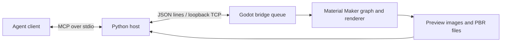

# Architecture and contracts

The Python process owns the MCP SDK, typed tool schemas, recipe data and temporary
image embedding. The Godot addon owns graph access and scheduling on the application's
main loop. Material Maker owns the shaders, material nodes and rendering.

## Request lifecycle

1. A client invokes a typed MCP tool. Structured outputs describe graphs and export
   manifests; visual tools return MCP image content.
2. The Python client sends one JSON object with an action, arguments and request ID.
   A process-wide lock serializes calls originating in the same host process.
3. The addon collects complete UTF-8 lines and places known actions into a shared
   queue. The queue awaits one handler at a time, including handlers that yield
   while the renderer updates. This applies across independent host processes.
4. Success returns the result and duration. Failures carry a code, explanation and,
   where available, recovery suggestions and details. The host checks response IDs.

The transport uses a fresh TCP connection per request. There is no cancellation or
exactly-once retry contract: after a timeout, inspect the graph before retrying a
mutation because the application may still complete it.

## Graph and preview state

Session material IDs identify tabs explicitly. An ID becomes invalid when its tab
closes or the app restarts. Use IDs for every operation when multiple tabs are open.

Fragment validation checks node types, aliases, declared parameters, references,
ports and cycles before applying up to 256 nodes as an undoable graph operation.
Individual graph-edit tools do not provide the same whole-fragment validation.

Preview capture uses Material Maker's real 3D viewport. It waits for the target
graph's dependency buffers, captures a requested image size, and restores viewport
and model settings. The wrapper restores the previously active tab on reported
validation errors as well as success.

Variation sweeps cap the Cartesian product at 64 combinations and restore original
parameter values, dirty state and active tab after success or reported render
failure. These are in-process recovery guarantees; a process crash, GDScript runtime
exception, timeout or concurrent manual UI edit is outside that guarantee. The
queue serializes individual bridge actions, not entire multi-call client workflows.

Exports return matching files, channels, byte sizes and SHA-256 hashes. A fresh,
dedicated output prefix prevents old files from being mistaken for new results.
The live smoke check independently verifies the hashes against file contents.

## Trust boundary

Use this only with trusted clients on a single-user workstation. The bridge binds
to IPv4 loopback and has no authentication. Loopback is not protection against
other processes or users on the machine. No arbitrary shell/Python/GDScript
evaluation endpoint is provided, but material operations can load files and write
to caller-supplied paths with the application's permissions, including overwriting
existing outputs. This is not a filesystem sandbox.

MCP tool annotations are client hints, not access controls. Read-only previews use
temporary files and temporarily change renderer/UI state. Inspect a preview before
keeping or exporting a result, and avoid manual editing during automation.

The request limit is 8 MiB; the host response limit is 32 MiB. Preview dimensions are
64–2048 pixels. The request queue and client count are not designed to resist an
untrusted local denial-of-service client. Do not expose the bridge through a proxy.
